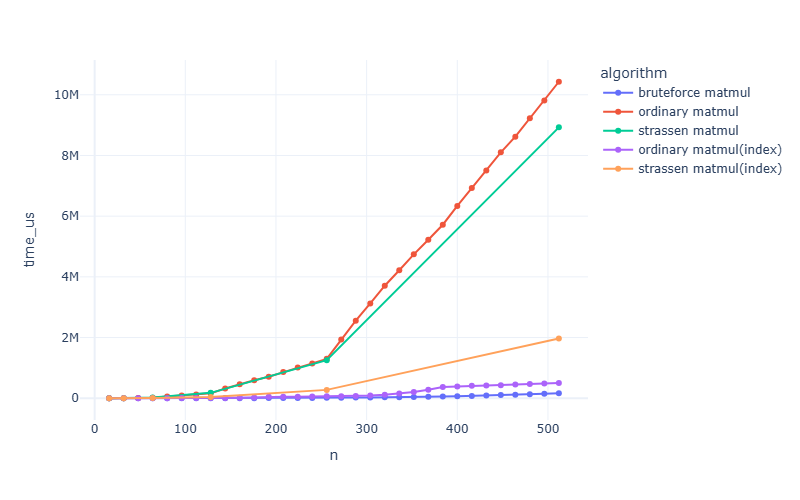
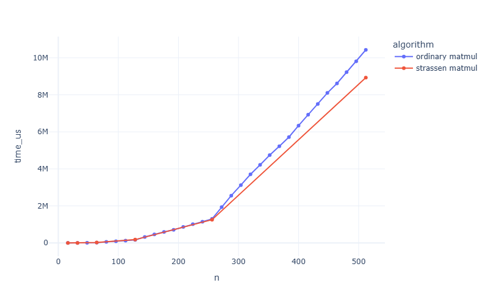
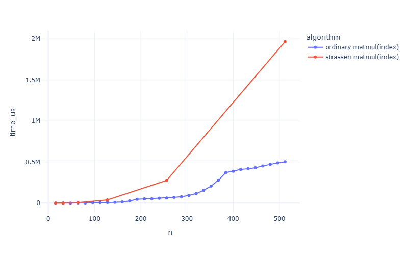
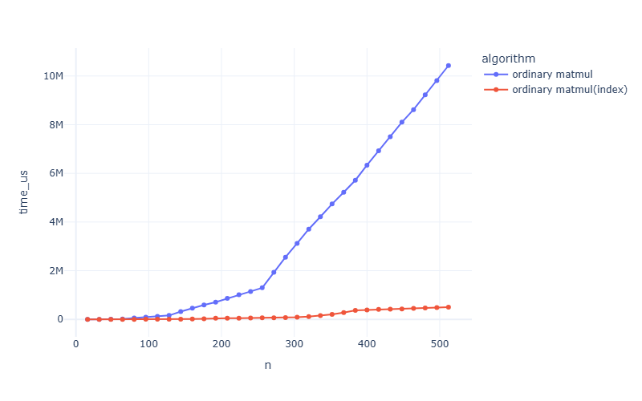
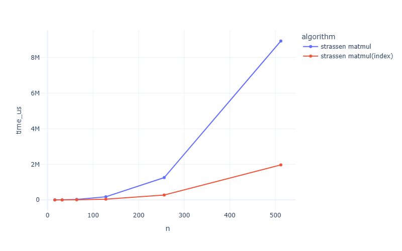
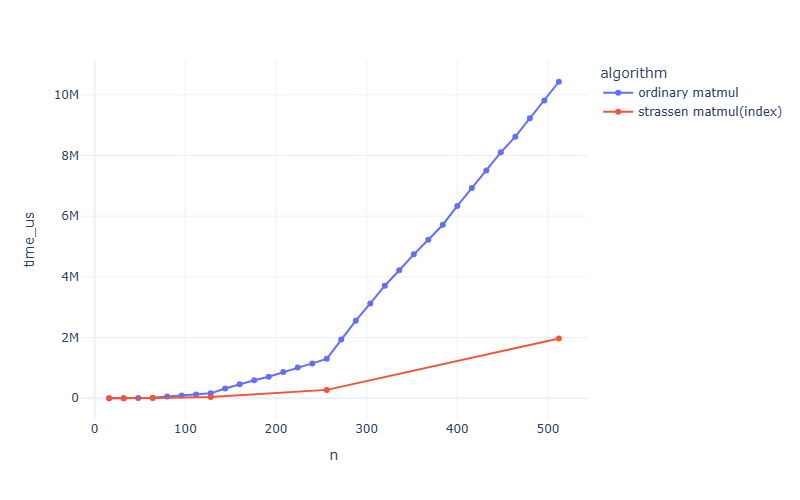

### Data Structure Lab1. Matrix Multiplication

Shiqiang Wu
24300810019@m.fudan.edu.cn

#### Part I. Lab Structure
- `matmul.h`

    My implementation of **`Strassen’s algorithm`** and **`ordinary algorithm`** and `bruteforce algorithm` of the matrix multiplication.
    > Notice:
     The `matmul_strassen` only support the multiplication of two square matrixes whose num of row/col are $2^n$. 
     To make the algorithm work for matrixes of all nums of row, the `matmul_strassen_padding` is created using a small padding trick.
- `matmul_pro.h`

    Better implementation of the algorithms above.    
- `matadd.h`

    My implementation of the matrix addition and substraction.
- `matmul_test.cpp`

    Some test examples to make sure that the  **`Strassen’s algorithm`** and **`ordinary algorithm`** and `bruteforce algorithm` of the matrix multiplication work fine.
- `benchmark.cpp`

    measure the operating time of different algorithms and output it to `data\result.csv`
- `visualization.ipynb`

    jupyter notebook to visualize the result.

There are four kind of matrix multiplication algorithms:
- bruteforce matmul

    simply use 3 for loops to perform the matrix multiplication, by its defination.$$O(N^3)$$ 
    - `matmul_bruteforce`
- ordinary matmul

    use naive divide and conquer algorithms to perform matrix multiplication.$$O(N^3)$$ \
    Two implementations:
    - `matmul_ordinary`
        create matrixes and allocate lots of space again and again when operating.
    - `matmul_ordinary_index`
        simply pass the indexes in recursion, save memories.
- strassen matmul
    use Strassen's algorithms, only applies to matrixes whose number of row is $2^n$.$$O(N^{log_2^7})$$ \
    Two implementation:
    - `strassen_ordinary`
        create matrixes and allocate lots of space again and again when operating.
    - `strassen_ordinary_index`
        pass the indexes in recursion, allocate less spaces.
- strassen matmul padding
    pad the matrixes of any size to a square matrixes whose number of row is $2^n$, and then use the strassen algorithm.\
    Two implementation:
    - `strassen_ordinary_padding`
    - `strassen_ordinary_padding_index`
#### Part II. Experiment
> To have better computing resource than my own laptop so that the experiment can apply to larger data, I use an Aliyun ECS to perform the experiment.
1. Check the correctness of the algorithm
   ```bash
    g++ matmul_test.cpp -o matmul_test
    ./matmul_test
   ```

   ```bash
    ----------------------------test0, bruteforce-------------------------
    start testing...
    m1=
    |       1       0       -4      |
    |       7       0       1       |
    |       2       5       8       |

    m2=
    |       2       1       2       |
    |       1       8       5       |
    |       9       0       1       |

    m1 @ m2=
    |       -34     1       -2      |
    |       23      7       15      |
    |       81      42      37      |

    end testing
    ----------------------------test1, ordinary---------------------------
    start testing...
    m1=
    |       1       0       -4      |
    |       7       0       1       |
    |       2       5       8       |

    m2=
    |       2       1       2       |
    |       1       8       5       |
    |       9       0       1       |

    m1 @ m2=
    |       -34     1       -2      |
    |       23      7       15      |
    |       81      42      37      |

    end testing
    ----------------------------test2, ordinary---------------------------
    start testing...
    m1=
    |       1       0       0       |
    |       0       0       1       |
    |       1       1       4       |
    |       5       1       4       |

    m2=
    |       2       1       2       5       |
    |       1       8       5       1       |
    |       6       3       2       4       |

    m1 @ m2=
    |       2       1       2       5       |
    |       6       3       2       4       |
    |       27      21      15      22      |
    |       35      25      23      42      |

    end testing
    ----------------------------test3, strassen---------------------------
    start testing...
    m1=
    |       1       0       |
    |       0       1       |

    m2=
    |       2       1       |
    |       5       1       |

    m1 @ m2=
    |       2       1       |
    |       5       1       |

    end testing
    ----------------------------test4, strassen---------------------------
    start testing...
    m1=
    |       1       0       8       1       |
    |       0       1       4       5       |
    |       9       5       1       4       |
    |       7       5       1       2       |

    m2=
    |       2       1       4       1       |
    |       5       1       9       9       |
    |       7       -2      6       5       |
    |       8       9       6       4       |

    m1 @ m2=
    |       66      -6      58      45      |
    |       73      38      63      49      |
    |       82      48      111     75      |
    |       62      28      91      65      |

    end testing
    ----------------------------test5, strassen padding-------------------
    start testing...
    m1=
    |       1       0       -4      |
    |       7       0       1       |
    |       2       5       8       |

    m2=
    |       2       1       2       -1      |
    |       1       8       5       -9      |
    |       9       0       1       4       |

    m1 @ m2=
    |       -34     1       -2      -17     |
    |       23      7       15      -3      |
    |       81      42      37      -15     |

    end testing
    ----------------------------test6, ordinary(index)---------------------------
    start testing...
    m1=
    |       1       0       -4      |
    |       7       0       1       |
    |       2       5       8       |

    m2=
    |       2       1       2       |
    |       1       8       5       |
    |       9       0       1       |

    m1 @ m2=
    |       -34     1       -2      |
    |       23      7       15      |
    |       81      42      37      |

    end testing
    ----------------------------test7, ordinary(index)---------------------------
    start testing...
    m1=
    |       1       0       0       |
    |       0       0       1       |
    |       1       1       4       |
    |       5       1       4       |

    m2=
    |       2       1       2       5       |
    |       1       8       5       1       |
    |       6       3       2       4       |

    m1 @ m2=
    |       2       1       2       5       |
    |       6       3       2       4       |
    |       27      21      15      22      |
    |       35      25      23      42      |

    end testing
    ----------------------------test8, strassen(index)---------------------------
    start testing...
    m1=
    |       1       0       |
    |       0       1       |

    m2=
    |       2       1       |
    |       5       1       |

    m1 @ m2=
    |       2       1       |
    |       5       1       |

    end testing
    ----------------------------test9, strassen(index)---------------------------
    start testing...
    m1=
    |       1       0       8       1       |
    |       0       1       4       5       |
    |       9       5       1       4       |
    |       7       5       1       2       |

    m2=
    |       2       1       4       1       |
    |       5       1       9       9       |
    |       7       -2      6       5       |
    |       8       9       6       4       |

    m1 @ m2=
    |       66      -6      58      45      |
    |       73      38      63      49      |
    |       82      48      111     75      |
    |       62      28      91      65      |

    end testing
    ---------------------------test10, strassen padding(index)-------------------
    start testing...
    m1=
    |       1       0       -4      |
    |       7       0       1       |
    |       2       5       8       |

    m2=
    |       2       1       2       -1      |
    |       1       8       5       -9      |
    |       9       0       1       4       |

    m1 @ m2=
    |       -34     1       -2      -17     |
    |       23      7       15      -3      |
    |       81      42      37      -15     |

    end testing
    ```
2. Compare the operating times of different algorithm
   First, compile and run `benchmark.cpp` to generate the csv file

    ```bash
    g++-11 -O3 -march=native -fopenmp benchmark.cpp -o benchmark
    ./benchmark
    ```
    
    Then run the `visualization.ipynb` to show the result.
    
#### Part III. Result analysis    
In the `visualization.ipynb`

Comparison of all algorithms:


Sadly, no matter how big I'm trying to adjust the data, the `brute_force matmul` performs best, even on the Aliyun ECS. This may be because of my recurisive implementations, which occupy lots of memories and make the constant factors so big.

But we can compare the performances of `ordinary matmul` and `strassen matmul`.

When we compare the performance of the two algorithms implemented in the naive ways, we can find that the `strassen matmul` outperforms `ordinary matmul` when processing matrixes large enough.

When we take a look at the improved ways of the two algorithms, we can find that the ordinary(index) works much well than the other, because the improvement of ordinary way(totally no need to allocate memory) is much more than the other's(still need to allocate memory, but less)


Now let's observe the improvements



We can find that the improved strassen works much better than the naive ordinary algorithm.
