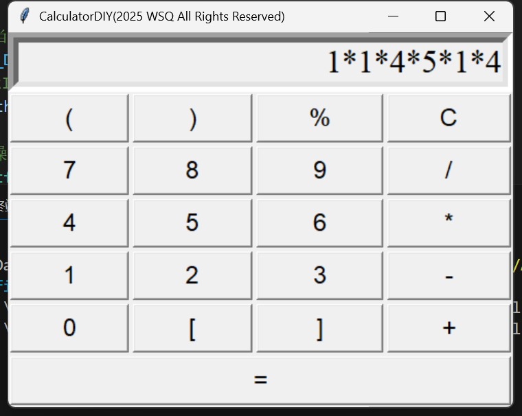

### Lab 2 Postfix Calculator
Shiqiang Wu 24300810019@m.fudan.edu.cn
{width=400}
#### Part I. Lab Structure
- Head files
    - `postfix_cal.h`
        **Calculating the postfix expression.**
    - `in2post.h`
        **Transform the infix expression to the postfix expression.**
    - `calculator.h`
        Implementation of the Calculator, we first transform the expression string from postfix expression, then use `postfix_cal.h` to calculate the result.
    - `string2vec.h`
- Test `cpp` files
    - `postfix_cal_test.cpp`
        Test for `postfix_cal.h`
    - `in2post_test.cpp`
        Test for `in2post.h`
    - `caltest.cpp`
        Test for `calculator.h`
- `calculator_core.cpp`
    generate `calculator.dll`
- `Makefile`
- `calculator_gui.py`
    Python GUI for the Calculator

#### Part II.Quick Start
##### Testing
```bash
mingw32-make
```
```bash
.\postfix_cal_test
```
```bash
Test 1:
6 4 + 7 2 - / 
result = 2
-----------Test 1 passed------------
Test 2:
6 7 * 5 8 + % 
result = 3
-----------Test 2 passed------------
Test 3:
1 3 + 2 4 + * 6 - 8 2 - /
result = 3
-----------Test 3 passed------------
```
```bash
.\in2post_test
```
```bash
Test 1:
Infix: ( 6 + 2 ) / 4 
Postfix: 6 2 + 4 / 
--------------------------------------
Test 2:
Infix: [ ( 1 + 3 ) * ( 2 + 4 ) - 6 ]
Postfix: 1 3 + 2 4 + * 6 -
--------------------------------------
Test 3:
Infix: ( 1 + 9 ) * ( 8 + 9 ) / ( 6 - 4 )
Postfix: 1 9 + 8 9 + * 6 4 - /
--------------------------------------
Test 4:
Infix: [ ( 1 + 3 ) * ( 2 + 4 ) - 6 ] / ( 9 - 7 ) % 2
Postfix: 1 3 + 2 4 + * 6 - 9 7 - / 2 %
--------------------------------------
Test 5:
Infix: 5 - 2 + 1
Postfix: 5 2 - 1 +
--------------------------------------
```
```bash
.\caltest
```
```bash
Test 1:
4+8*2 = 20
True
-------------------------------------
Test 2:
1 * 1 * 4 * 5 * 1 * 4 = 80
True
-------------------------------------
Test 3:
[(4+3-1)/(7%5)-4]*10/(2-5+8) = -2
True
-------------------------------------
```
#### Calculator GUI
```bash
python calculator_gui.py
```

> **Vibe Coding:**
> I use the VSCode Copilot to help write the GUI python file