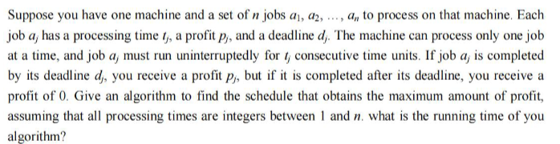

### Lab4 Dynamic Programming and Greedy Algorithm

24300810019@m.fudan.edu.cn

Shiqiang Wu

#### Part I. Question and the DP Analysis
##### Question:

This is a classic problem in scheduling theory, often solved using Dynamic Programming and Greedy Algorithm.
```cpp
/*Action Class*/
class Action{
    public:
        int time;
        double profit;
        int deadline;
        std::string information;
};
```
The API of the `max_profit` function:
```cpp
int max_profit(std::vector<Action>& actions, int total_time, std::vector<std::pair<Action, int>>& result)
``` 
##### Basic Ideas of the Algorithm
- **Greedy Algorithm in deadline sorting**
    We get a list of `Action`s with arbitary order, the first thing that we need to do is somehow sort them to prepare for the next step processing.
    Intutively, we may sort the `Action`s in the order of their `deadline`s, since actions with nearer deadline are more emergent to process.Leaving actions with the furthest deadline at the end can give more space for other actions.
```cpp
std::sort(actions.begin(), actions.end(), action_compare_ddl);
```
- **Dynamic Programming in time and actions**
After sorting the actions, we get a list of actions in the order of the deadlines:
$$\{a_1, a_2, a_3, ..., a_n\}$$
and their ddl:
$$\{d_1, d_2, d_3, ..., d_n\}$$
Together with the time$[0, \text{total time}]$, we can do Dynamic Programming.
**We define the subproblem $DP(k, t)$:**
    - Using actions in $\{a_1, a_2, a_3, ...a_k\}$
    - In the time $[0, t]$ 

We can either choose to add a new action $a_k$ at the end of $t$**(case 0)**, or just using former set of actions $\{a_1, a_2, a_3, ...a_{k-1}\}$ at time t **(case 1)**, or do nothing but let the time flow by 1 **(case 2)**.

**The state transfer function:**

$$
DP[i][j] = \max \begin{cases} DP[i][j-1] & \text{（在 } j-1 \text{ 结束比在 } j \text{ 结束更好, case \ 2）} \\ DP[i-1][j] & \text{（不选 } a_i \text{，且在 } j \text{ 之前结束, case \ 1）} \\ p_i + DP[i-1][j - t_i] & \text{（选 } a_i \text{，在 } j \text{ 结束，且 } j \le d_i, case \ 0） \end{cases}
$$
    
**Notice:**
- When the time $t$ is beyond the deadline of the action $a_i$ 's deadline, we cannot consider case 0.
- When the time $t$ is smaller than the action $a_i$ 's time to be spent on, we cannot consider case 0.
****

#### Part II. Implementation and Test
**All implementations of the algorithm is in the `maxprofit.h`**

There are 3 test samples in `maxprofit_test.cpp` to validate the correctness of the algorithm:
**Test 1:**
```bash
================Start testing====================
Max Profit =31
coding : 
  start at: 0
  end at:   4
do math homework : 
  start at: 4
  end at:   9
train deep neural network : 
  start at: 9
  end at:   15
play soccer : 
  start at: 15
  end at:   16
sleep : 
  start at: 16
  end at:   23
dating with girl friend : 
  start at: 23
  end at:   24
================End testing======================
```
**Test 2:**
```bash
================Start testing====================
Max Profit =161
第一个五年计划 :
  start at: 0
  end at:   5
贯彻落实三个代表重要思想 :
  start at: 5
  end at:   15
构建社会主义和谐社会 :
  start at: 15
  end at:   25
改革开放 :
  start at: 25
  end at:   55
中国特色社会主义进入新时代 :
  start at: 55
  end at:   65
一国两制统一中国 :
  start at: 65
  end at:   70
================End testing======================
```
**Test 3:**
```bash
================Start testing====================
Max Profit =195
冲刺中考 :
  start at: 0
  end at:   3
卷高考，考复旦 :
  start at: 3
  end at:   6
保研推免 :
  start at: 6
  end at:   10
直博毕业 :
  start at: 10
  end at:   15
博士毕业 :
  start at: 15
  end at:   19
初中毕业，下海经商 :
  start at: 19
  end at:   29
中年危机 :
  start at: 29
  end at:   32
非升即走 :
  start at: 32
  end at:   35
退休万岁 :
  start at: 35
  end at:   40
================End testing======================
```
#### Part III. Time Complexity
Suppose we have **$n$ actions**, with the **total time $T$** given.
- In the greedy sorting of the deadline, the time complexity should be:
$$O(n\log{n})$$
- In the Dynamic Programming process, the time complexity should be:
$$O(nT)$$

Thus the complexity is:
$$O(n\log{n} + nT)$$

Ordinarily, we suppose that $n$ actions each cost time no longer than $n$, and total time $T$ given is less or equal to $n^2$.
So that the time complexity:
$$O(n\log{n} + nT) \leq O(n^3)$$ 