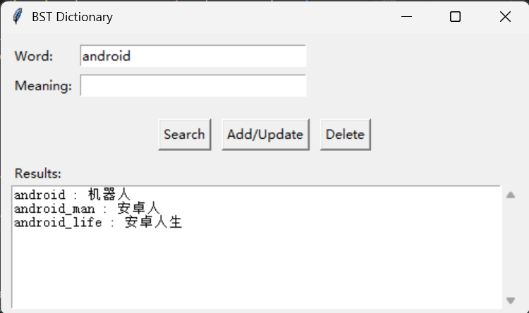
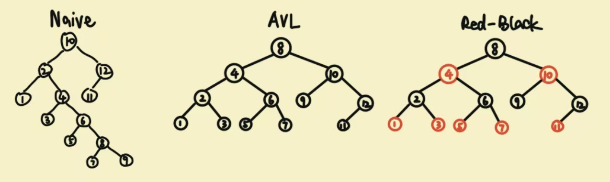
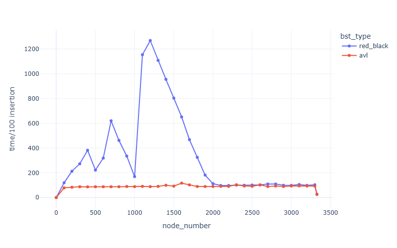
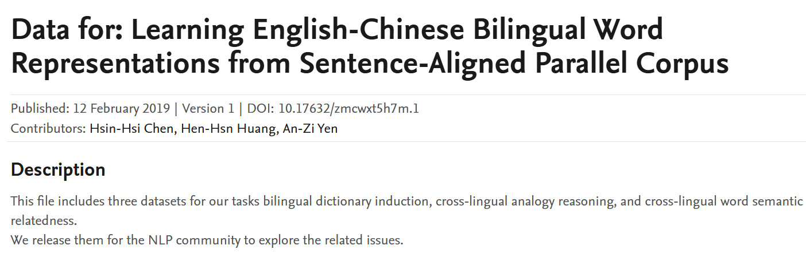
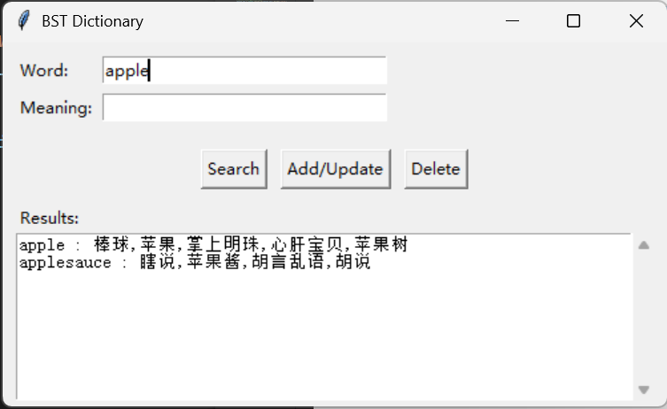

### Project 2: BST Dictionary

Shiqiang Wu 24300810019@m.fudan.edu.cn
***
#### Project Structure

The project is organized as follows:

```bash
Project2 BST Dictionary/
├── README.md                     # Project documentation
├── Makefile                      # Build script for compiling the DLL library
├── io.h                          # I/O utilities for reading dictionary data files
├── dictionary_final.cpp          # Command-line interface for the dictionary
├── dictionary_lib.cpp            # C++ library bridge for Python GUI integration
├── gui.py                        # Python GUI application using Tkinter
├── test_search.py                # Testing script for search functionality
│
├── bst/                          # Directory for BST-related headers
│   ├── node.h                    # Definition of the node structure
│   ├── naive_bst.h               # Base BST implementation with core operations
│   ├── avl.h                     # AVL tree (self-balancing BST) implementation
│   └── red_black.h               # Red-Black tree implementation (used in dictionary)
│
├── bst_tests/                    # Unit tests for BST implementations
│   ├── naive_bst_test.cpp        # Tests for naive BST
│   ├── avl_test.cpp              # Tests for AVL tree
│   ├── red_black_test.cpp        # Tests for Red-Black tree
│   ├── naive_bstt.txt            # Result of tests for naive BST
│   ├── avlt.txt                  # Result of tests for AVL tree
│   └── red_blackt.txt            # Result of tests for Red-Black tree
│
├── dictionary_tests/             # Dictionary functionality tests
│   ├── naive_dictionary.cpp      # Dictionary using naive BST
│   ├── avl_dictionary.cpp        # Dictionary using AVL tree
│   ├── rb_dictionary.cpp         # Dictionary using Red-Black tree
│   └── full_dict.cpp             # Full dictionary test with all operations
│
├── dictionary_benchmark/         # Performance benchmarking
│   ├── benchmark.cpp             # C++ benchmark implementation
│   ├── benchmark.ipynb           # Jupyter notebook for benchmark analysis
│   └── init_benchmark.csv        # Benchmark results data
│
├── data/                         # Dictionary data files
│   ├── en_cn.txt                 # English-Chinese dictionary data (20,000+ entries)
│   ├── init.txt                  # Initialization data
│   ├── insert.txt                # Test data for insertion
│   └── delete.txt                # Test data for deletion
│
└── img/                          # Images for documentation
```
***
#### I.BST Wheels
<div style="background-color: #fff3cd; padding: 10px; border-left: 4px solid #ffc107; margin: 10px 0;">

- [x] **BST Wheels**
    - [x] `naive_bst.h`
        - [x] Insert
        - [x] Delete
        - [x] Search
          - [x] single value search
          - [x] range search
        - [x] PreOrder_print
    - [x] `red_black.h`(inherit from `naive_bst`)
        - [x] Insert(override)
        - [x] Delete(override)
        - [x] PreOrder_print(override)
    - [x] `avl.h`(inherit from `naive_bst`)
        - [x] Insert(override)
        - [x] Delete(override)
    > Search methods used in three kind of BSTs are the same.
</div>

Use test examples in `./bst_tests` to validate the correctness of wheel implementation.

**Initial Tests**
> **Notice:**
> Beyond the `preorder_print()` method required in the project, I add a `breadthfirstwalk_print()` method in `naive_bst.h`to better visualize the tree for tests.


```bash
    // Naive BST
    10(root)
    2(l, 10)        12(r, 10)
    1(l, 2) 4(r, 2) 11(l, 12)
    3(l, 4) 6(r, 4)
    5(l, 6) 8(r, 6)
    7(l, 8) 9(r, 8)
```
```bash
    // AVL
    8(root)
    4(l, 8) 10(r, 8)
    2(l, 4) 6(r, 4) 9(l, 10)        12(r, 10)
    1(l, 2) 3(r, 2) 5(l, 6) 7(r, 6) 11(l, 12)
```
```bash
    // RED-BLACK
    8(root, BLACK)
    4(l, 8, RED)    10(r, 8, RED)
    2(l, 4, BLACK)  6(r, 4, BLACK)  9(l, 10, BLACK) 12(r, 10, BLACK)
    1(l, 2, RED)    3(r, 2, RED)    5(l, 6, RED)    7(r, 6, RED)    11(l, 12, RED)
```
```bash
    // RED-BLACK
    我(root, BLACK)
    发财(l, 我, BLACK)      韩国瑜(r, 我, BLACK)
    发大财(l, 发财, BLACK)  就要(r, 发财, BLACK)    秃子(l, 韩国瑜, RED)    高雄(r, 韩国瑜, BLACK)
    出征(l, 发大财, RED)    月亮(l, 秃子, BLACK)    跟着(r, 秃子, BLACK)
    走(l, 跟着, RED)
```
**Delete Test**
```bash
    // Naive BST
    -------------------------Testing Tree Deletion------------------
    --------------------------------------------------------------
    8(root)
    4(l, 8) 10(r, 8)
    2(l, 4) 6(r, 4) 9(l, 10)        12(r, 10)
    1(l, 2) 3(r, 2) 5(l, 6) 7(r, 6) 11(l, 12)
    --------------------------------------------------------------
    --------------------------------------------------------------
    8(root)
    4(l, 8) 10(r, 8)
    2(l, 4) 6(r, 4) 9(l, 10)        12(r, 10)
    1(l, 2) 5(l, 6) 7(r, 6) 11(l, 12)
    --------------------------------------------------------------
    --------------------------------------------------------------
    8(root)
    4(l, 8) 10(r, 8)
    1(l, 4) 6(r, 4) 9(l, 10)        12(r, 10)
    5(l, 6) 7(r, 6) 11(l, 12)
    --------------------------------------------------------------
    --------------------------------------------------------------
    8(root)
    4(l, 8) 10(r, 8)
    1(l, 4) 6(r, 4) 12(r, 10)
    5(l, 6) 7(r, 6) 11(l, 12)
    --------------------------------------------------------------
    --------------------------------------------------------------
    8(root)
    5(l, 8) 10(r, 8)
    1(l, 5) 6(r, 5) 12(r, 10)
    7(r, 6) 11(l, 12)
    --------------------------------------------------------------
    --------------------------------------------------------------
    8(root)
    5(l, 8) 12(r, 8)
    1(l, 5) 6(r, 5) 11(l, 12)
    7(r, 6)
    --------------------------------------------------------------
    --------------------------------------------------------------
    8(root)
    5(l, 8) 12(r, 8)
    1(l, 5) 6(r, 5)
    7(r, 6)
    --------------------------------------------------------------
    --------------------------------------------------------------
    12(root)
    5(l, 12)
    1(l, 5) 6(r, 5)
    7(r, 6)
    --------------------------------------------------------------
```

```bash
    // AVL
    -------------------------Testing Tree Deletion------------------
    --------------------------------------------------------------
    8(root)
    4(l, 8) 10(r, 8)
    2(l, 4) 6(r, 4) 9(l, 10)        12(r, 10)
    1(l, 2) 3(r, 2) 5(l, 6) 7(r, 6) 11(l, 12)
    --------------------------------------------------------------
    --------------------------------------------------------------
    8(root)
    4(l, 8) 10(r, 8)
    2(l, 4) 6(r, 4) 9(l, 10)        12(r, 10)
    1(l, 2) 5(l, 6) 7(r, 6) 11(l, 12)
    --------------------------------------------------------------
    --------------------------------------------------------------
    8(root)
    4(l, 8) 10(r, 8)
    1(l, 4) 6(r, 4) 9(l, 10)        12(r, 10)
    5(l, 6) 7(r, 6) 11(l, 12)
    --------------------------------------------------------------
    --------------------------------------------------------------
    8(root)
    4(l, 8) 11(r, 8)
    1(l, 4) 6(r, 4) 10(l, 11)       12(r, 11)
    5(l, 6) 7(r, 6)
    --------------------------------------------------------------
    --------------------------------------------------------------
    8(root)
    5(l, 8) 11(r, 8)
    1(l, 5) 6(r, 5) 10(l, 11)       12(r, 11)
    7(r, 6)
    --------------------------------------------------------------
    --------------------------------------------------------------
    8(root)
    5(l, 8) 11(r, 8)
    1(l, 5) 6(r, 5) 12(r, 11)
    7(r, 6)
    --------------------------------------------------------------
    --------------------------------------------------------------
    6(root)
    5(l, 6) 8(r, 6)
    1(l, 5) 7(l, 8) 12(r, 8)
    --------------------------------------------------------------
    --------------------------------------------------------------
    6(root)
    5(l, 6) 12(r, 6)
    1(l, 5) 7(l, 12)
    --------------------------------------------------------------
```
    
```bash
    // RED-BLACK
    -------------------------Testing Tree Deletion------------------
    --------------------------------------------------------------
    8(root, BLACK)
    4(l, 8, RED)    10(r, 8, RED)
    2(l, 4, BLACK)  6(r, 4, BLACK)  9(l, 10, BLACK) 12(r, 10, BLACK)
    1(l, 2, RED)    3(r, 2, RED)    5(l, 6, RED)    7(r, 6, RED)    11(l, 12, RED)
    --------------------------------------------------------------
    --------------------------------------------------------------
    8(root, BLACK)
    4(l, 8, RED)    10(r, 8, RED)
    2(l, 4, BLACK)  6(r, 4, BLACK)  9(l, 10, BLACK) 12(r, 10, BLACK)
    1(l, 2, RED)    5(l, 6, RED)    7(r, 6, RED)    11(l, 12, RED)
    --------------------------------------------------------------
    --------------------------------------------------------------
    8(root, BLACK)
    4(l, 8, RED)    10(r, 8, RED)
    1(l, 4, BLACK)  6(r, 4, BLACK)  9(l, 10, BLACK) 12(r, 10, BLACK)
    5(l, 6, RED)    7(r, 6, RED)    11(l, 12, RED)
    --------------------------------------------------------------
    --------------------------------------------------------------
    8(root, BLACK)
    4(l, 8, RED)    11(r, 8, RED)
    1(l, 4, BLACK)  6(r, 4, BLACK)  10(l, 11, BLACK)        12(r, 11, BLACK)
    5(l, 6, RED)    7(r, 6, RED)
    --------------------------------------------------------------
    --------------------------------------------------------------
    8(root, BLACK)
    5(l, 8, RED)    11(r, 8, RED)
    1(l, 5, BLACK)  6(r, 5, BLACK)  10(l, 11, BLACK)        12(r, 11, BLACK)
    7(r, 6, RED)
    --------------------------------------------------------------
    --------------------------------------------------------------
    8(root, BLACK)
    5(l, 8, RED)    11(r, 8, BLACK)
    1(l, 5, BLACK)  6(r, 5, BLACK)  12(r, 11, RED)
    7(r, 6, RED)
    --------------------------------------------------------------
    --------------------------------------------------------------
    8(root, BLACK)
    5(l, 8, RED)    12(r, 8, BLACK)
    1(l, 5, BLACK)  6(r, 5, BLACK)
    7(r, 6, RED)
    --------------------------------------------------------------
    --------------------------------------------------------------
    5(root, BLACK)
    1(l, 5, BLACK)  7(r, 5, RED)
    6(l, 7, RED)    12(r, 7, BLACK)
    --------------------------------------------------------------
```

**PreOrder Walk**
```bash
    // RED-BLACK
    level=0 child=0 don't(BLACK)
    level=1 child=0 calm(RED)
    level=2 child=0 and(BLACK)
    level=3 child=0 null
    level=3 child=1 null
    level=2 child=1 carry(BLACK)
    level=3 child=0 null
    level=3 child=1 dark(RED)
    level=4 child=0 null
    level=4 child=1 null
    level=1 child=1 keep(RED)
    level=2 child=0 go(BLACK)
    level=3 child=0 gentle(RED)
    level=4 child=0 null
    level=4 child=1 null
    level=3 child=1 into(RED)
    level=4 child=0 null
    level=4 child=1 null
    level=2 child=1 on(BLACK)
    level=3 child=0 night(RED)
    level=4 child=0 null
    level=4 child=1 null
    level=3 child=1 null
```

***
#### II.Tiny Dictionary Test
In `./dictionary_test`, run 3 test files
`dictionary_tests/avl_dictionary.cpp`,`dictionary_tests/rb_dictionary.cpp`,`dictionary_tests/naive_bst_dictionary.cpp`

**Query and Delete Tests**
```bash
antimissile的意思是: 反导弹的
christolatry的意思是: 崇拜基督
collectivization的意思是: 集体化
brassiere的意思是: 奶罩
copulatory的意思是: 交配的
capias的意思是: 拘票
adjutage的意思是: 喷射管
bawdily的意思是: 淫秽地
bran的意思是: 糠麸
abuttals的意思是: 地界
creeper的意思是: 爬行者
batt的意思是: 棉絮
centum的意思是: 百
awny的意思是: 有芒的
curiosity的意思是: 好奇心
bidentate的意思是: 有二齿的
autofill的意思是: 自动填充
```
**Range Search Tests**
```cpp
rb1.range_search("android", "apple");
```
```bash
android antihuman annuli angrily aneurysm anemophily anecdotical androphagous andrology anecdotage
anemology anelasticity anemometry anesthesiology anent anemoscope anesthesiologist aneuploid anesthetist
aneurism angelophany angelically angelet anew angelica angelological angelologic angelology angler angled 
angiosperm anglepod anglo anglistics anglophobe ankyloglossia anility anhydride angular anguilliform 
anhinga aniconism anhydrous anigh anime animalcule animal animalize anisette anion ankle anniversary 
annalistic anna anlace annal annealing annam annexation announcing annotator annoit announceable annularly 
annuities annulation anthography antemeridian antarctica anonymous annulus annulose annum anourous 
anorthic anta antehall antebrachium antares antechamber antelucan antelope antemarital anteport antennate 
antenna antemortem antennal antenuptial antennule anteporch antewar anteprohibition anteprandial antetype 
anther anthelion antheral antibilious anthroponym anthrop anthophagy anthologize anthracite anthropologic 
anthropolatry anthropology antiaircraft anthropophagy anthropophagous anthroposophy antiauxin antianxity 
antiballistic anticorrosive anticaries antiblack antibiosis antibody anticline anticipative 
anticompetitive antifeudal antidotal anticyclonic antidraft antigropelos antiforeign antihelix aphlogistic 
antitoxic antipasto antimony antimatter antimacassar antilope antimagnetic antimissile antimechanized 
antimonsoon antinomy antinode antineutron antinoise antiozonant antinucleon antiparallel antiresonance 
antiphrasis antipersonnel antipatriotic antiphonary antipsychotic antiproton antiquated antisymmetric 
antiskid antiserum antispeculation antitheist antitheism antithesis aorta anxiolytic antonym antivirus 
antitoxin antonomasia anuresis antonymy anus anywhere anyplace anyone anything anzam anywise anzuk 
apetalous apepsia apanage aortic apatite aperiodicity aperiodically aperitif apheliotropic aphasia apex 
aphasiology aphemic aphemia aphis applausively apoise aplite apiarist aphrodisia aphorist apian apiculus 
apiculture apiology apogean apodia apocarpy apodosis apogeotropism apogee apograph apparente aposematic 
apologized apolaustic apologizer apotropaion apostolic appal appeaser appealable apparently appeasement 
appendicle appellor appertain 
```

***

#### III.Time Analysis
In `./dictionary_benchmark`
1. **Initial Analysis**
    Run `benchmark.cpp`.
    We insert every 100 words from `data/init.txt` each time to initalize the tree, and record the time of inserting every 100 words into `init_benchmark.csv`
    we can visualize the result in `benchmark.ipynb`
    
2. **Delete and Insert Analysis**
   Repeat the `delete` and `insert` operation, each for words in `data/delete.txt` and `data/insert.txt`(for 200 times and get the average).
3. **Search and Range Search Analysis**
    Generate one or two random strings and perform search and range search for 200 times, get the average time.
    ```bash
        red-black average delete time(ms): 41
        red-black average insert time(ms): 88
        avl average delete time(ms): 69
        avl average insert time(ms): 96
        red-black average search time(ns): 8850
        avl average search time(ns): 661
        red-black average range search time(ns): 53897
        avl average range search time(ns): 48907
    ```

***
#### IV. Usable Dictionary and Dictionary GUI
<div style="background-color: #fff3cd; padding: 10px; border-left: 4px solid #ffc107; margin: 10px 0;">

**Vibe Coding Warning:**
    In this project, only this part uses vibe coding. I use VS Code Copilot to help generate programs to generate the GUI.
</div>
To construct a dictionary that can really be used in real life, we need a bigger dataset than the toy.



https://data.mendeley.com/datasets/zmcwxt5h7m/1

We get bigger a dataset in `data\en_cn.txt`

We use the red-black tree to build the dictionary.

Run `dictionary_terminal.cpp` to perform in the terminal
```bash
    Initializing the dictionary...........
    Initialize the dictionary complete

    Welcome to the Red-Black Tree Dictionary!
    Available commands:
    search <word>  - Find words starting with <word>
    add <word> <meaning> - Add a new word and its meaning
    delete <word>  - Delete a word
    exit           - Exit the program
    -------------------------------------------

    > search shanghai
    Searching for words starting with "shanghai"...
    - shanghai: 诱拐

    > add shanghai 上海
    Word "shanghai" already exists. Overwriting.

    > search shanghai
    Searching for words starting with "shanghai"...
    - shanghai: 上海

    > search girl
    Searching for words starting with "girl"...
    - girl: 恋人,女佣,妞,姑娘,阿姨,情人,闺女,少女,爱人,女,女仆,丫头,女人,女子,女工,女儿,女朋友,女孩,女郎,女孩子,女侍
    - girlhood: 少女时代
    - girlfriend: 女朋友,情人,女友

    > search love
    Searching for words starting with "love"...
    - loveliness: 魅力,可爱,美丽,动人,漂亮
    - love: 慈爱,零分,敬慕,爱慕,爱好,爱人,爱,爱,需要,怜爱,热爱,欢,欢,欢心,恋,恋爱,慈悲,艳情,爱情,恋爱,求爱,爱恋,意中人,友爱,心疼,心爱,春,茂盛,恩爱,情,喜爱,嗜好,嗜,善意,情爱,喜爱,喜好,喜好,贪恋, 喜欢
    - loved: 甜美
    - lover: 情人,爱好者,恋人,情郎,情侣,情夫,相好,求婚者,爱人,心上人,冤家
    - lovely: 妩媚,乖巧,娇,空灵,可爱
    - lovemaking: 求婚,调情,寄情,做爱,性交,求爱

    > delete loved
    Deleted "loved".

    > search love
    Searching for words starting with "love"...
    - loveliness: 魅力,可爱,美丽,动人,漂亮
    - love: 慈爱,零分,敬慕,爱慕,爱好,爱人,爱,爱,需要,怜爱,热爱,欢,欢,欢心,恋,恋爱,慈悲,艳情,爱情,恋爱,求爱,爱恋,意中人,友爱,心疼,心爱,春,茂盛,恩爱,情,喜爱,嗜好,嗜,善意,情爱,喜爱,喜好,喜好,贪恋, 喜欢
    - lover: 情人,爱好者,恋人,情郎,情侣,情夫,相好,求婚者,爱人,心上人,冤家
    - lovely: 妩媚,乖巧,娇,空灵,可爱
    - lovemaking: 求婚,调情,寄情,做爱,性交,求爱
``` 

Run `mingw32-make` to generate `dictionary_lib.dll`, then `python dictionary_gui.py` to get the dictionary GUI.
