<div align="center">
<h2>Data Structure Project 3: Chengdu Metro Map </h2>

:metro:

<p>
<b>Shiqiang Wu</b><sup>1</sup>, 
</p>

<p>
<sup>1</sup>College of Computer Science and Artificial Intelligence, Fudan University &nbsp;&nbsp; 
</p>

24300810019@m.fudan.edu.cn
</div>

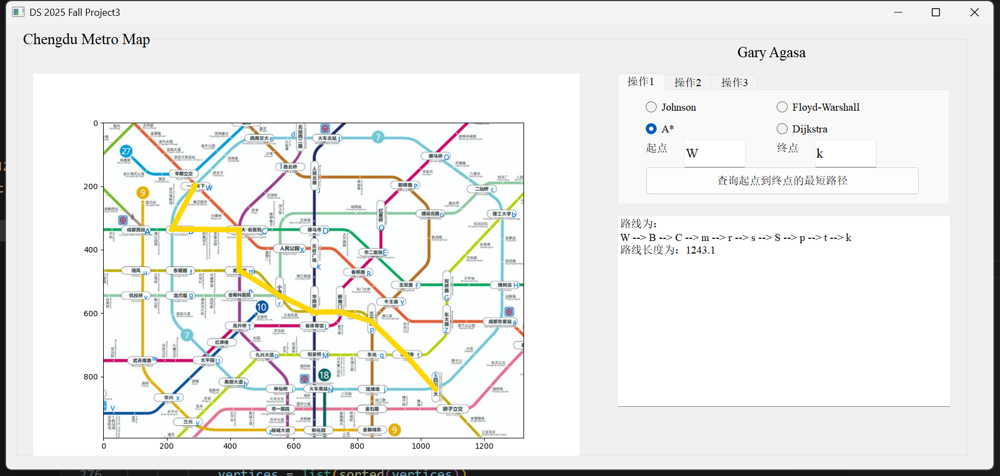


### Environment Dependencies
See in `requirements.txt`
```
pybind11>=2.6.0
PyQt5>=5.15.0
numpy>=1.21.0
matplotlib>=3.5.0
pandas>=1.3.0
setuptools>=45.0
wheel>=0.36.0
```
:rocket:
**Conda Package Management**
```bash
conda create - n ds_pj3 python=3.10
conda activate ds_pj3
pip install -r requirements.txt
```

### Quick Start
:fireworks::fireworks::fireworks:
```bash
conda activate ds_pj3
python setup.py build_ext --inplace --compiler=mingw32 
```
This will generate `metro_core.cp312-win_amd64.pyd`
```bash
python python/main_window.py
```
**Then you can generate with the GUI and use the map to navigate** :) 

`走成华大道(bushi)`
### Project Structure

```bash
Project3_Chengdu_Metro_Map/
├── README.md
├── setup.py                       
├── requirements.txt                # Python依赖列表
├── data/                           # datasets
│   ├── edge.txt
│   ├── vertex.txt
├── src/                            # C++ source code
│   ├── bindings/                   # pybind11 binding
│   │   ├── pybind_module.cpp
│   ├── graph/                      
│   │   ├── graph.h                 # 邻接表图定义, FW 以及 MatMul 算法实现
│   │   ├── graph_matrix.h          # 邻接矩阵图定义
│   │   ├── ret_format.h            # 返回值结构定义
│   │   ├── utils.h
│   │   ├── utils.cpp               # 工具函数实现
│   ├── mst/                        # 最小生成树算法
│   │   ├── kruskal.h
│   │   ├── kruskal.cpp
│   │   ├── prim.h
│   │   ├── prim.cpp
│   ├── path/                       
│   │   ├── astar.h                 
│   │   ├── astar.cpp               # A* 算法实现
│   │   ├── dijkstra.h
│   │   ├── dijkstra.cpp            # Dijkstra 算法实现
│   │   ├── floyd_warshall.h
│   │   ├── floyd_warshall.cpp      # FW 以及 MatMul 算法实现
├── python/                         
│   ├── data_loader.py              # 数据加载
│   ├── main_window.py              # 主UI窗口
│   ├── metro_algorithms.py         # 算法包装接口
│   ├── Ui_navigator.py             # UI生成代码
```

### Part 1. Shortest Path
- **Function 1: One-To-One Shortest Path**  :snake:
- **Function 2: One-To-All Shortest Path** :dragon:
  
For each function, there are 4 algorithm to implement it.

#### 1. Dijkstra Algorithm
`src/path/dijkstra.cpp`
- Function 1:
    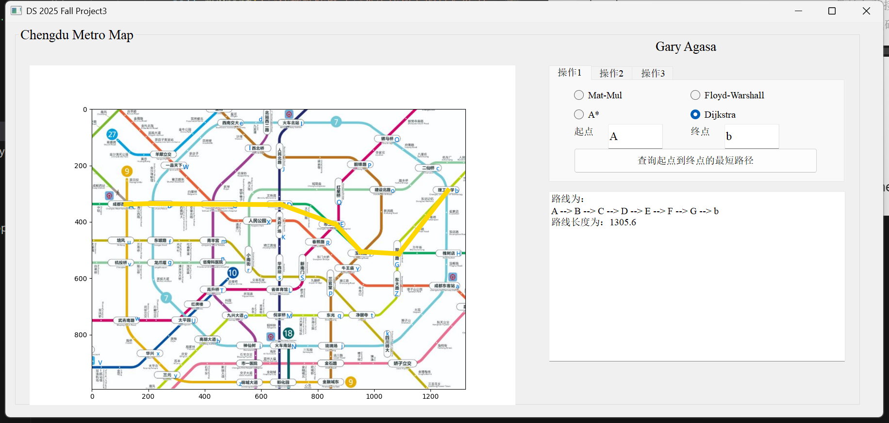
- Function 2:
    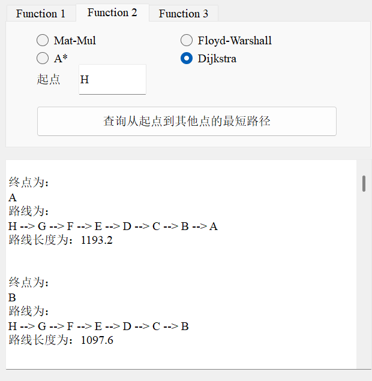
Fringe Operations:
    
```cpp
    while(!fringe.empty()){
        Vertex* poped_node_ptr = fringe.top();
        fringe.pop();

        // Handle the problem of repeating DE-FRINGE
        if(poped_node_ptr->color == 2){
            continue;
        }

        poped_node_ptr->color = 2;

        // Find the end point
        if(poped_node_ptr->id == end){
            path = rebuild_path();
            dist = poped_node_ptr->distance;
            is_found = true;
            break;
        }

        for(auto& neighbor : poped_node_ptr->adjacency){
            Vertex* neighbor_ptr = graph.getVertex(neighbor.first);
            double way_dist = neighbor.second;
            
            if(neighbor_ptr->color != 2){
                // Relaxation Operation
                if(neighbor_ptr->distance > (poped_node_ptr->distance + way_dist)){
                    neighbor_ptr->distance = poped_node_ptr->distance + way_dist;
                    neighbor_ptr->predecessor = poped_node_ptr->id;
                }
                neighbor_ptr->color = 1;
                fringe.push(neighbor_ptr);
            }
        }

    }
```

Dijkstra sorts the vertex in the fringe according to their distance to the source, also the:

$$g(n)$$ 

The time complexity of the Dijkstra is:

$$O(E\log(V))$$

#### 2. A\* Algorithm
`src/path/astar.cpp`
- Function 1:
    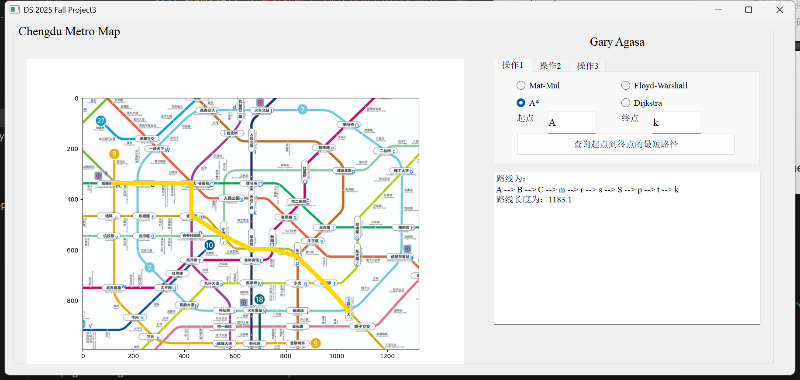
- Function 2:
    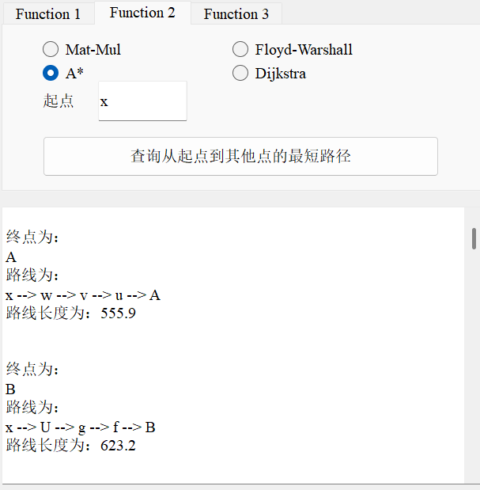
Fringe Operations:
    
```cpp
    while(!fringe.empty()){
        Vertex* poped_node_ptr = fringe.top();
        fringe.pop();

        // Handle the problem of repeating DE-FRINGE
        if(poped_node_ptr->color == 2){
            continue;
        }
        
        poped_node_ptr->color = 2;

        // Find the end point
        if(poped_node_ptr->id == end){
            path = rebuild_path();
            dist = poped_node_ptr->distance;
            is_found = true;
            break;
        }

        for(auto& neighbor : poped_node_ptr->adjacency){
            Vertex* neighbor_ptr = graph.getVertex(neighbor.first);
            double way_dist = neighbor.second;
            
            // The heuristic function is consistent
            if(neighbor_ptr->color != 2){
                // Relaxation Operation
                if(neighbor_ptr->distance > (poped_node_ptr->distance + way_dist)){
                    neighbor_ptr->distance = poped_node_ptr->distance + way_dist;
                    neighbor_ptr->predecessor = poped_node_ptr->id;
                }
                neighbor_ptr->color = 1;
                fringe.push(neighbor_ptr);
            }
        }
    }
```

[Wikipedia of A\*](https://en.wikipedia.org/wiki/A*_search_algorithm)
    


A* sorts the vertex in the fringe according to their distance to the source $s$ plus the estimated distance from the destination $t$, also the:

$$f(n) = g(n) + h(n)$$ 
    
where the $g(n)$ is the distance to the source and $h(n)$ is the distance from the estimation. \
For the heuristic function $h(n)$, there are some requirements(properties) it may have: 

>   **Admissible:** \
    $\forall u \in V$, $h(u) \leq dist(u, t)$ \
    **Consistent:** \
    $\forall u, v \in V$, $h(u) - h(v) \leq dist(u,v)$

A right heuristic function should be at least **admissible** .If it is also **consistent**, then it will be more convenient to process the fringe in our algorithm.

In the project, I choose the euclidean distance to be the heuristic function, which is both admissible and consistent.
    
$$h(u) = \sqrt{(u_x - t_x)^2 + (u_y - t_y)^2}$$

The time complexity of the A\* is:

$$O(E\log(V))$$

(similar to dijkstra, but add the heuristic mechanism)
#### 3. "Mat-mul Algorithm"(From the book **Algorithm**)

This cute nick name is created by me:)
    
`src/path/floyd_warshall.cpp`
- Function 1:
    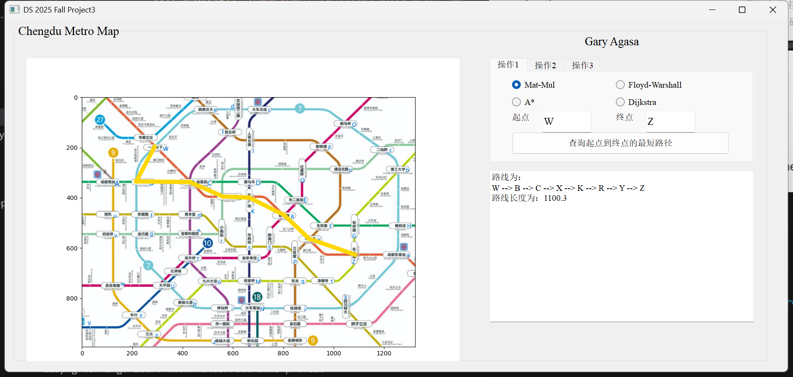
- Function 2:
    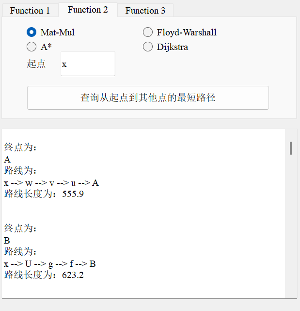

The core part of the Dynamic Programming:
```cpp
    d_and_pi matmul_extend(d_and_pi& dp_i){
        d_and_pi dp_i1(dp_i);
        
        for(int i = 0; i < num_vertices; i++){
            for(int j = 0; j < num_vertices; j++){
                // Update the shortest path value at position (i, j)
                // Try all possible intermediate nodes
                double dis_current = dp_i1.d[i][j];
                for(int k = 0; k < num_vertices; k++){
                    // Dynamic Programming
                    double dis_newtrial = dp_i.d[i][k] + adj_matrix[k][j];
                    if(dis_newtrial < dis_current){
                        // Update
                        dis_current = dis_newtrial;
                        dp_i1.d[i][j] = dis_current;
                        dp_i1.pi[i][j] = k;
                    }
                }
            }
        }
        return dp_i1;
    }
```
The time complexity of the MM is:

$$O(V^4)$$

as we don't use the "matrix multiplication" to optimize, but implement in a bruteforce way.
#### 4. Floyed-Warshall Algorithm
`src/path/floyd_warshall.cpp`

- Function 1:
    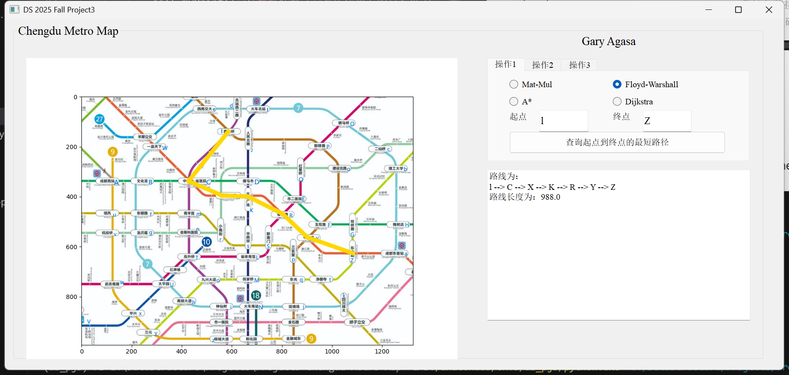
- Function 2:
    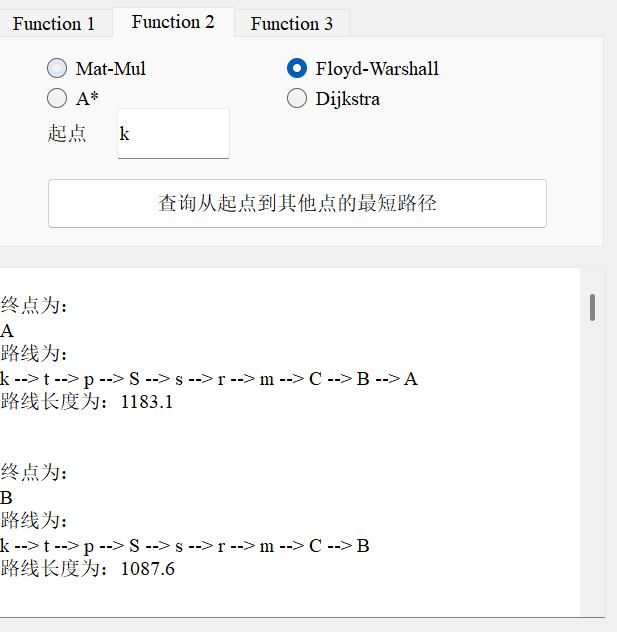

The core part of the Dynamic Programming:
    
```cpp
    d_and_pi fw_extend(d_and_pi& dp_i, int k){
        // we allow the vertex k to used for the first time
        d_and_pi dp_i1 = dp_i;

        for(int i = 0; i < num_vertices; i++){
            for(int j = 0; j < num_vertices; j++){
                // Dynamic Programming
                double dis_newtrial = dp_i.d[i][k] + dp_i.d[k][j];
                if(dis_newtrial < dp_i1.d[i][j]){
                    // Update
                    dp_i1.d[i][j] = dis_newtrial;
                    dp_i1.pi[i][j] = dp_i.pi[k][j];
                }
            }
        }

        return dp_i1;
    }
```
The time complexity of the FW is:

$$O(V^3)$$

> :dog: **Notice:**
> Since in this map there are no neigative-weighted edges, I don't implement the Johnson Algorithm as it can be seen as the repeative usage of the dijkstra Algorithm

### Part 2. Minimum Spanning Tree
**Function 3**

#### 1. Kruskal
- `src/mst/kruskal.cpp`
    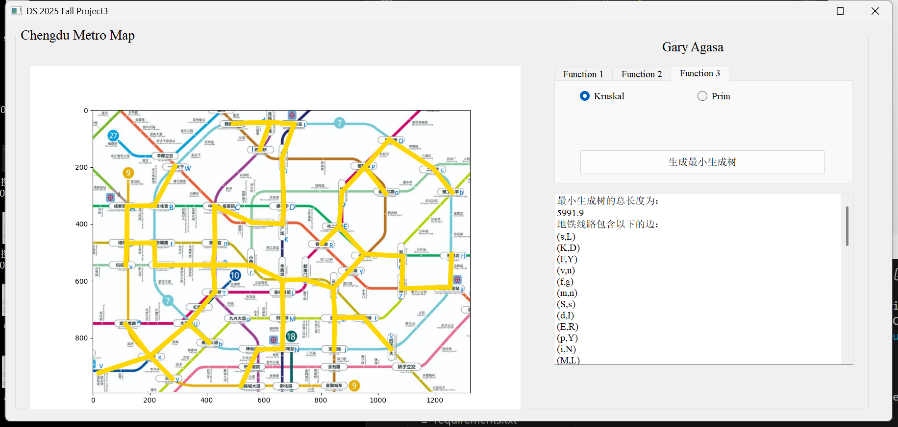
    ```cpp
        MSTResult kruskal_mst(Graph& graph) {
        int num_vertices = graph.getVertexCount();
        std::vector<Edge> all_edges = graph.getAllEdges();

        auto cmp = [](Edge e1, Edge e2) -> bool{
            return e1.second > e2.second;
        };

        // Priority Queue to sort the edge in the order of the length(ascending)
        std::priority_queue<Edge, std::vector<Edge>, decltype(cmp)> pq(cmp);
        for(auto e : all_edges){
            pq.push(e);
        }
        // Disjoint set of the vertices
        Disjoint_Set ds(num_vertices);
        MSTResult ret;
        ret.success = false;
        ret.total_weight = 0;
        
        while(!pq.empty() && ret.edges.size() < num_vertices - 1){
            Edge e_poped = pq.top();
            pq.pop();

            int set_index1 = ds.find_set(string2index(e_poped.first.first));
            int set_index2 = ds.find_set(string2index(e_poped.first.second));
            if(set_index1 == set_index2){
                continue;
            }
            ds.union_set(set_index1, set_index2);
            ret.edges.emplace_back(e_poped.first.first, e_poped.first.second);
            ret.total_weight += e_poped.second;
        }

        if(ret.edges.size() == num_vertices - 1){
            ret.success = true;
        }

        return ret;
    }
    ```
    
    Time Complexity of Kruskal:
    $$O(E\log(V))$$
#### 2. Prim
- `src/mst/prim.cpp`
    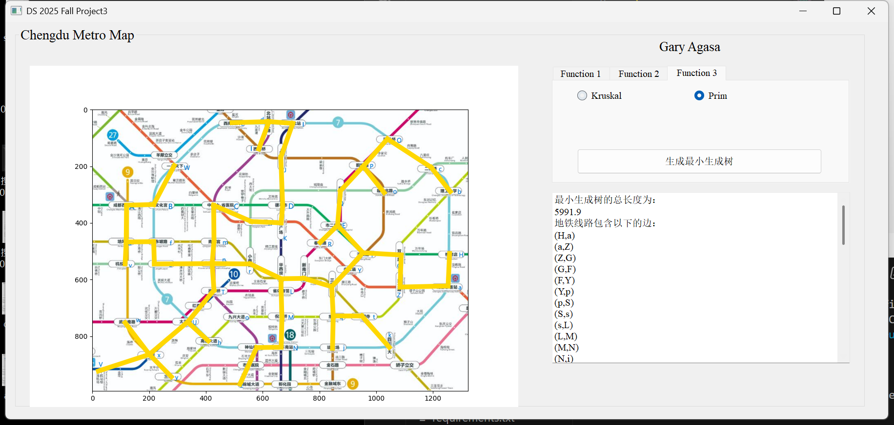

    ```cpp
        MSTResult prim_mst(Graph& graph, std::string start_vertex) {
        int num_vertices = graph.getVertexCount();
        // v_states: 0 for unvisited, 1 for visited
        std::vector<int> v_states(num_vertices, 0);

        auto cmp = [](Edge e1, Edge e2) -> bool{
            return e1.second > e2.second;
        };

        // Priority Queue to sort the edge in the order of the length(ascending)
        std::priority_queue<Edge, std::vector<Edge>, decltype(cmp)> pq(cmp);

        MSTResult ret;
        ret.success = false;
        ret.total_weight = 0;
        
        // Visit the first vertex(choose anywhere you like)
        Vertex* v = graph.getVertex(start_vertex);
        for(auto [n, d] : v->adjacency){
            pq.emplace(std::make_pair(start_vertex, n), d);
        }
        v_states[string2index(start_vertex)] = 1;

        while(!pq.empty() && ret.edges.size() < num_vertices - 1){
            Edge e_poped = pq.top();
            pq.pop();

            int neighbor_index = string2index(e_poped.first.second);
            if(v_states[neighbor_index] == 1){
                continue;
            }
            v_states[neighbor_index] = 1;
            Vertex* v = graph.getVertex(e_poped.first.second);
            for(auto [n, d] : v->adjacency){
                if(v_states[string2index(n)] == 0)
                    pq.emplace(std::make_pair(e_poped.first.second, n), d);
            }
            ret.edges.emplace_back(e_poped.first.first, e_poped.first.second);
            ret.total_weight += e_poped.second;
        }

        if(ret.edges.size() == num_vertices - 1){
            ret.success = true;
        }

        return ret;
    }
    ```

    Time Complexity of Prim:
    $$O(E\log(V))$$

### Acknowlegement
1. 本项目参考了2023年秋季学期郑骁庆老师的课程项目，使用了[Oxlord-lin](https://github.com/Oxlord-Lin)同学开源的代码框架和UI并在此基础上进行改进，特在此表示感谢！原项目全部使用Python语言，本项目所有核心算法代码使用C++进行重写。更改了数据集。对于有关功能进行了调整和扩展。不涉及抄袭问题。
https://github.com/Oxlord-Lin/FDU-2023Fall-Data-Structure-Homework/tree/master/PJ-2
2. 地图数据来自于成都地铁官网提供的路线图(https://www.chengdurail.com/ckfw/xlt.htm)
3. 本项目致敬了加州大学伯克利分校CS61B数据结构课程的BearMap :bear: 课程项目(https://sp18.datastructur.es/materials/proj/proj3/proj3)

### Vibe Coding Clarification
In this project, I use VSCode Copilot to help build the GUI. All core codes of graph algorithms in C++ are coded without the help of the LLMs.